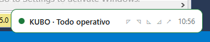
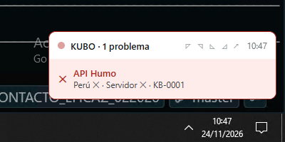
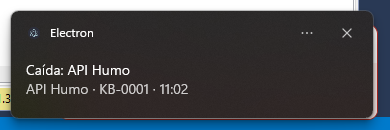
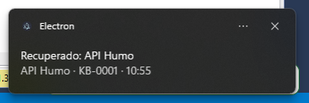
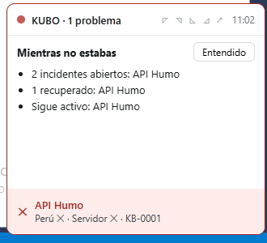

# Aceptación de la Entrega 2 (Escritorio) — Monitoreo de disponibilidad

> **Renumeración (2026-11-24):** al integrar `main`, que trajo el conector de tickets con su `031_conector_repos.sql`, las migraciones de disponibilidad pasaron a ser `032_disponibilidad_nucleo.sql` (antes 031) y `033_disponibilidad_escritorio.sql` (antes 032). Este documento usa ya los números nuevos; los mensajes de commit citados conservan el número con el que se hicieron.

Fecha de las comprobaciones: **2026-11-24**. Rama: `feat/monitoreo-escritorio` (sin publicar, sin fusionar).
Criterios: secciones «El widget», «Notificaciones de Windows» y «Vigilancia de las propias sondas» de `docs/superpowers/specs/2026-11-23-monitoreo-disponibilidad-design.md`.

## Resumen para el responsable

- Todas las pruebas automáticas pasan y todo compila.
- Se hizo una prueba de humo local y desechable (base de datos, backend, motor y widget en modo desarrollo). Se vio el widget plegado y desplegado, los avisos de Windows de caída y de recuperación, y el resumen al iniciar sesión.
- **No se instaló el widget con el instalador, no se tocó producción y no se registró ningún inicio automático** en esta PC.
- Tras la revisión final se corrigió que un corte de internet de la oficina diera 2–3 avisos: ahora da **uno solo** (sección 3, decisión 11).
- Quedan pendientes comprobaciones que solo usted puede hacer (sección 4): sobre todo instalar con el instalador por usuario, ver que arranca con la sesión, que Windows no silencia los avisos y que el clic en un aviso abre el incidente. **Los pasos D7, D9 y D10 actúan sobre la PC y la central reales**: lea la advertencia al inicio de la sección 4.

Estados usados:

- **VERIFICADO**: se comprobó en el entorno local el 2026-11-24, con la evidencia indicada.
- **CUBIERTO POR PRUEBAS**: lo demuestra una prueba automática (no se reprodujo a mano).
- **PENDIENTE DEL USUARIO**: requiere la PC de la oficina, el instalador o infraestructura real.
- **FUERA DE ESTA ENTREGA**: la spec lo asigna a otra entrega.

## 1. Pruebas automáticas (2026-11-24, tras las correcciones de la revisión final)

| Comprobación | Resultado |
|---|---|
| `packages/monitoring-core`: `npx jest` | 5 suites, **65/65** OK |
| `backend`: `node scripts/sync-monitoring-core.mjs --check` | código de salida 0 («Copia al día con la fuente») |
| `backend`: `npx jest` | 137 suites, **2707/2707** OK |
| `backend`: `npm run build` | OK |
| `desktop/engine`: `npx jest` | 7 suites, 92 OK y 1 omitida a propósito (solo corre fuera de Windows) |
| `desktop/engine`: `npm run build` | OK |
| `desktop/widget`: `npx jest` | 8 suites, **74/74** OK |
| `desktop/widget`: `npm run build` | OK (comprobación de tipos, compilación y paquete de la interfaz) |
| `desktop/widget`: `npx electron-builder --win --dir` | OK (`dist/win-unpacked/KUBO Monitor.exe`, no se ejecutó) |

El instalador NSIS se compiló una vez solo para comprobar que acepta el script de desinstalación (`installer/uninstall.nsh`); **no se ejecutó** y se borró después.

## 2. Criterios de aceptación

### 2.1 El widget

| # | Requisito de la spec | Estado | Evidencia |
|---|---|---|---|
| W1 | Ventana sin marco, siempre encima | **VERIFICADO** (ventana) | Se vio la ventana sin marco sobre el escritorio en la prueba de humo (capturas 01 a 05, sección 6). Las opciones (`frame: false`, `alwaysOnTop` nivel `screen-saver`, sin barra de tareas) están en `desktop/widget/src/main/window.ts`. Que quede encima de otras aplicaciones no se probó a mano: ver D3 |
| W2 | Fijable en cualquier esquina | **CUBIERTO POR PRUEBAS** + manual pendiente | `window-position.spec.ts`: `positionFor` en las cuatro esquinas con margen 12 y `nearestCorner`. Arrastrar y soltar no se ejercitó con el ratón: ver D5 |
| W3 | Plegada es una barra «KUBO · Todo operativo · hora» | **VERIFICADO** | Captura 01 (barra verde «KUBO · Todo operativo · 10:56») |
| W4 | Rojo ante caída o sin acceso | **VERIFICADO** | Captura 02: fila roja «API Humo · Perú ✕ · Servidor ✕ · KB-0001», icono de bandeja rojo. Tonos y colores: `widget-model.spec.ts` |
| W5 | Ámbar (verificando, degradado, disco bajo, central caída) | Verificando: **observado en la prueba (sin captura)** / resto: **CUBIERTO POR PRUEBAS** | En el humo se observó el widget en ámbar «KUBO · 1 problema» mientras se verificaba (10:46); no se tomó captura. Degradado, central caída y central que rechaza: `widget-model.spec.ts`. Disco bajo viene del agente de servidor: **FUERA DE ESTA ENTREGA** |
| W6 | Gris con el motor caído | **CUBIERTO POR PRUEBAS** + manual pendiente | `widget-model.spec.ts` y `engine-client.spec.ts` (sin respuesta, 401/403, **30 s** de gracia «Conectando…» al arrancar el widget). Apagar el servicio y verlo: ver D7 |
| W7 | Se despliega solo, una fila por problema | **VERIFICADO** | Capturas 01 y 02: de barra plegada a una fila al aparecer el problema. Altura según filas (hasta 6, luego desplazamiento): `window-position.spec.ts`. Un corte de internet de la oficina es **una** fila («Sin internet en la oficina»), sin la de la central: `widget-model.spec.ts` |
| W8 | Cada fila indica qué ve cada sonda («Perú ✕ · Servidor ✓ · TCK») | **VERIFICADO** | Captura 02. Combinaciones de marcas: `widget-model.spec.ts` |
| W9 | Fila de servidor se despliega en sus servicios | **CUBIERTO POR PRUEBAS** + manual pendiente | `window-position.spec.ts` (fila de servidor con 3 servicios: 1 fila plegada, 4 desplegada; `sanitizeUnfolded`) y `widget-model.spec.ts`. El clic en el triángulo no se probó a mano: ver D4 |
| W10 | Un clic en una fila abre el incidente en la web | **CUBIERTO POR PRUEBAS** + manual pendiente | `notify-policy.spec.ts` (`isAllowedUrl`: solo el mismo origen de la central, sin credenciales en la URL, rutas bajo `/monitoreo/`; rechaza `javascript:`) y validación del identificador en `main.ts`. El clic real y la apertura del navegador no se probaron: ver D6 |
| W11 | «Abrir tablero» abre la sección Monitoreo | **CUBIERTO POR PRUEBAS** + manual pendiente | Misma lista de URL permitidas. Ver D8 |
| W12 | Arranca con la sesión del usuario, sin elevación | **PENDIENTE DEL USUARIO** | Instalador NSIS por usuario, sin elevación (`electron-builder.yml`: `perMachine: false`, `allowElevation: false`); el inicio automático se registra solo con la aplicación empaquetada y una vez, en `HKCU\Software\Microsoft\Windows\CurrentVersion\Run` con el nombre `com.kubo.monitor.widget`. Al desinstalar se borra (no en las actualizaciones). No se instaló. Ver D1, D2 y D12 |
| W13 | Icono en la bandeja con: mostrar widget, abrir tablero, ver incidentes, probar notificación, ver salud del monitor | **CUBIERTO POR PRUEBAS** + PENDIENTE DEL USUARIO | La bandeja se vio por su icono de color en el humo, pero el menú no se abrió con el ratón. Lógica de «Salud del monitor»: `health.spec.ts`. Ver D8 |
| W14 | Al iniciar sesión muestra un resumen de lo ocurrido y destaca lo que sigue activo | **VERIFICADO** (resumen) | Captura 05: «Mientras no estabas: 2 incidentes abiertos: API Humo · 1 recuperado: API Humo · Sigue activo: API Humo» con «Entendido» y la fila roja debajo; los eventos viejos no se vuelven a avisar. **El resumen se provocó atrasando a mano `lastSeenAt` en `widget-state.json`** y reabriendo el widget, no con un inicio de sesión real. Reglas de conteo (incidentes abiertos y recuperados por incidente; «la central no responde» dentro de un corte de oficina no se cuenta aparte): `login-summary.spec.ts`. El inicio de sesión real de Windows: ver D2 |

### 2.2 Notificaciones de Windows

| # | Evento (spec) | Estado | Evidencia |
|---|---|---|---|
| N1 | Caída confirmada, criticidad Alta: aviso, widget, ticket P1 | **VERIFICADO** | Captura 03 («Caída: API Humo … KB-0001»), fila roja y ticket `KB-0001`. **El aviso capturado es el de la reapertura de las 11:02** (el incidente se recuperó y volvió a caer durante el humo), no el de la primera caída. Se vio sobre el escritorio en modo desarrollo (los avisos salen como «Electron»); con el instalador: ver D6 |
| N2 | Sin acceso desde Perú (ROUTE), Alta: aviso, widget, ticket P1 | **CUBIERTO POR PRUEBAS** | `desktop/engine/test` (diario de eventos: `notify` verdadero para ROUTE de criticidad Alta) y `notify-policy.spec.ts` (títulos por tipo). No se reprodujo en local, igual que en la Entrega 1 |
| N3 | Recuperación de los dos anteriores: un aviso | **VERIFICADO** | Captura 04 («Recuperado: API Humo … KB-0001 · 10:55»); el widget volvió a verde. Un solo aviso por recuperación y recuperación parcial con solo los servicios recuperados: pruebas del motor |
| N4 | Caída o sin acceso, criticidad Media o Baja: sin aviso (sí widget y ticket) | **CUBIERTO POR PRUEBAS** | Pruebas del diario del motor (`notify` falso) y `notify-policy.spec.ts` («ignores events with notify false») |
| N5 | Degradación sostenida: sin aviso | **CUBIERTO POR PRUEBAS** | Pruebas del motor; el resumen al iniciar sesión también la ignora (`login-summary.spec.ts`) |
| N6 | Internet de oficina caído: un aviso agrupado | **CUBIERTO POR PRUEBAS** + cable pendiente | Un corte da **un solo aviso** (`OFFICE_OUTAGE_STARTED`): «la central no responde» queda solo en el historial y el regreso de internet (`OFFICE_OUTAGE_ENDED`) ya no avisa. Pruebas del motor «un corte, un aviso» (corte a mitad de franja, corte desde el arranque, franja medida antes del corte) y `notify-policy.spec.ts`. Corte real: ver D9 |
| N7 | La central no responde: aviso | **CUBIERTO POR PRUEBAS** | Tras 3 sondeos seguidos con fallos de red el motor espera el veredicto de oficina de la primera franja posterior al fallo: sin caída de oficina, `CENTRAL_UNREACHABLE` con aviso; con caída, sin aviso (ya avisó el corte); si la central vuelve antes, nada. Sin referencias configuradas avisa al momento; sin veredicto, 2 min después del fin de esa franja. Pruebas del diario del motor. El corte de la central con el motor real se reprodujo en la Entrega 1 (4d) |
| N8 | El motor no responde: aviso | **CUBIERTO POR PRUEBAS** + manual pendiente | `notify-policy.spec.ts` (`EngineDownTracker`: un aviso tras **3 lecturas caídas seguidas (≈15 s)** después de haberlo visto activo; no desde «conectando»; un tropiezo de 1–2 lecturas no avisa; se rearma al volver) y `poller.spec.ts`. Ver D7 |
| N9 | Disco con menos del 10 % libre (agente) | **FUERA DE ESTA ENTREGA** | Depende del agente de servidor |
| N10 | Fallo transitorio: ni aviso ni widget | **CUBIERTO POR PRUEBAS** | No genera eventos de aviso (pruebas del motor); verificado en datos en la Entrega 1 (3a) |
| N11 | Cada notificación abre el incidente correspondiente | **CUBIERTO POR PRUEBAS** + PENDIENTE DEL USUARIO | La URL del incidente se calcula y valida (`notify-policy.spec.ts`). Que Windows entregue el clic: ver D6 |
| N12 | Todo queda en el historial aunque Windows silencie el aviso | **CUBIERTO POR PRUEBAS** | El diario de eventos del motor es independiente de los avisos (también lo que no avisa: `CENTRAL_UNREACHABLE` durante un corte, `OFFICE_OUTAGE_ENDED`, `CENTRAL_BACK`); el widget lee el diario y el historial de la central es el de la Entrega 1 |

### 2.3 Vigilancia de las propias sondas

| # | Requisito de la spec | Estado | Evidencia |
|---|---|---|---|
| V1 | La central avisa por correo al personal si `oficina-01` calla 10 minutos | **CUBIERTO POR PRUEBAS** + PENDIENTE DEL USUARIO | `probe-silence.spec.ts` y `probe-silence.watch.spec.ts` (alerta a los 10 min, un solo correo, aviso de recuperación, escape de HTML, 2 min de gracia al arrancar el backend, sin administradores activos, y sin reenvío cada minuto si la marca no se puede guardar). Migración 033 (entonces 032) aplicada dos veces en una base desechable. Correo real: ver D10 |
| V2 | La vigilancia cubre ambas sondas | **CUBIERTO POR PRUEBAS** | Las mismas pruebas recorren todas las sondas con token, no solo la de la oficina |
| V3 | La oficina vigila a la central: 3 sondeos seguidos fallidos muestran «La central no responde» y un aviso; el motor sigue midiendo | **CUBIERTO POR PRUEBAS** | Motor (`central.reachable` falso tras 3 sondeos con fallos de red; el corte por rechazo no cuenta y se muestra «La central rechaza los envíos»), `widget-model.spec.ts` (ámbar «La central no responde»; «rechaza» tiene prioridad; con caída de oficina solo la fila de oficina). Aviso: ver N7. El corte real de la central con el motor corriendo, cola creciente y vaciado al volver se verificó en la Entrega 1 (4d) |
| V4 | El widget vigila al motor: sin respuesta de la API local, gris y aviso | **CUBIERTO POR PRUEBAS** + PENDIENTE DEL USUARIO | Ver N8 y W6. Ver D7 |

## 3. Decisiones y cambios respecto al plan

1. **Diario de eventos del motor.** El motor guarda un diario de eventos (con límite de 5000) y lo expone en `/v1/events`; el widget lo lee cada 5 s y decide los avisos. Así los avisos no dependen de que el widget estuviera abierto.
2. **Reglas de aviso:**
   - Un aviso por cada caída de servidor (incidente de servidor), no uno por servicio.
   - Un fallo nuevo de criticidad Alta siempre avisa, salvo que forme parte de una caída que ya se avisó.
   - La recuperación parcial nombra solo los servicios que se recuperaron.
   - Un mismo incidente no se avisa dos veces en 2 minutos.
3. **Arranque del motor.** El motor parte del último estado guardado, de modo que lo ocurrido mientras estuvo apagado (aperturas y recuperaciones) también queda en el diario y en el resumen. Riesgo asumido: una caída justo entre el diario y el guardado podría repetir una transición.
4. **«Sincronizar ahora» trae el código del ticket** mediante un servicio de sincronización aparte (`AvailabilitySyncService`), para que el trabajador de mediciones no dependa de tickets.
5. **Se vigilan las dos sondas** en la central (no solo la de la oficina), con 2 minutos de gracia tras arrancar el backend para no alertar por reinicios.
6. **El widget no calcula antigüedad de datos:** muestra el estado tal como llega; solo pone «–» si no hay dato. La frescura la decide el motor y la central.
7. **Inicio con la sesión solo si está empaquetado**, y una sola vez (`loginItemConfigured`): en desarrollo no se registra nada en la PC y quien lo desactive en el Administrador de tareas no se ve contradicho.
8. **Colores iguales a la web** (tarjeta clara con la paleta de `availability-ui.ts`), en lugar del vidrio oscuro del prototipo.
9. **Extras no previstos:** el puente expone `onHealth`/`closeHealth` para el panel «Salud del monitor»; la ventana es de una sola instancia; salida de compilación en `out/` (para no chocar con `dist/` del instalador).
10. **Endurecimiento:** vista de la interfaz con aislamiento y sandbox, política de contenido estricta, navegación y ventanas nuevas bloqueadas, solo se abren URL de la central bajo `/monitoreo/` (sin credenciales en la URL), y `runAsNode` desactivado en el ejecutable empaquetado.
11. **Un corte de internet de la oficina, un aviso** (revisión final). Sin internet tampoco hay central, y el umbral de «la central no responde» (~45 s) llega antes que el veredicto de caída de oficina (5–10 min de día). Ahora `CENTRAL_UNREACHABLE` queda pendiente hasta el veredicto de la primera franja que empieza después del primer sondeo fallido (las franjas anteriores se midieron con internet): con caída de oficina se anota sin aviso; sin caída, con aviso; si la central vuelve antes, no se anota. Sin referencias se decide al momento y, sin veredicto, 2 minutos después del fin de esa franja (con aviso). Si internet vuelve y la central sigue sin responder, se vuelve a decidir (ahora sí avisa). `OFFICE_OUTAGE_ENDED` y `CENTRAL_BACK` no avisan. El widget no muestra la fila de la central mientras hay caída de oficina y el resumen no cuenta ese «no responde» aparte. Para conocer cada veredicto (no solo los cambios), `monitoring-core` informa cada franja juzgada (`onOfficeVerdict`).
    - *Desviación de lo indicado («o tras 2 minutos»):* los 2 minutos se cuentan desde el fin de la primera franja que puede juzgar el fallo, no desde el umbral; con franjas de 5 min un plazo fijo de 2 min vencía casi siempre antes del veredicto y el corte volvía a dar dos avisos.
12. **«Rechaza» no es «no responde»** (revisión final). `central.reachable` cuenta solo los fallos de red/sync; con el corte por rechazo abierto el sync responde, así que el widget sigue diciendo «La central rechaza los envíos» (además comprueba «rechaza» antes que «no responde»). `consecutiveFailures` sigue contando ambos.
13. **Las marcas del diario sobreviven a un reinicio del motor** (revisión final): caída de oficina anotada, «no responde» anotado y el aviso pendiente se guardan en la tabla `kv` de `engine.db`. Un reinicio durante un corte no vuelve a avisar; si el corte terminó con el motor parado, el primer veredicto anota `OFFICE_OUTAGE_ENDED` (sin aviso).
14. **«El motor no responde» con margen** (revisión final): hacen falta 3 lecturas caídas seguidas (≈15 s) tras haberlo visto activo; un tropiezo puntual de la API local no avisa.
15. **Correo de silencio sin tormenta** (revisión final): si tras enviar el correo la marca de la central no se puede guardar (la fila cambió), se registra y no se reenvía cada minuto. La advertencia de «sin administradores» no se repite en la recuperación.
16. **Desinstalar quita el arranque con la sesión** (revisión final): el instalador incluye `installer/uninstall.nsh`, que borra el valor `com.kubo.monitor.widget` de `HKCU\…\Run` al desinstalar (no en una actualización, porque la app no lo vuelve a registrar).

## 4. Pendiente del usuario (pasos exactos y seguros)

Ninguno de estos pasos modifica producción ni exige credenciales. Los pasos D1 y D2 deben hacerse con un desarrollador.

> **Atención: D7, D9 y D10 actúan sobre la PC de la oficina y la central reales.**
>
> - Mientras duren D7, D9 y D10 **el monitoreo de la oficina está ciego**: lo que caiga en ese rato no se verá desde Perú hasta que vuelva el motor o internet (la cola se envía al volver).
> - **D10 envía correos reales a todos los administradores activos** de la central (uno al callar la sonda y otro al volver).
> - Si en ese momento hay un problema real en algún servicio, **puede abrirse un ticket real**.
> - Recomendación: avise antes al equipo (administradores incluidos) y hágalo en una ventana tranquila, fuera de horas punta, con alguien mirando el tablero.
> - **Si aparecen tickets durante D9** (corte del cable): la regla de caída de oficina debería evitarlos; si aun así se abre alguno, anote su código y la hora, no lo cierre a mano hasta reconectar y verificar en el tablero si era real, y comuníquelo al desarrollador (sería un defecto).

- **D1. Construir el instalador.** En `desktop/widget`, en PowerShell: si existe la variable `ELECTRON_RUN_AS_NODE` en esa terminal (algunos editores la heredan), quítela con `Remove-Item Env:ELECTRON_RUN_AS_NODE -ErrorAction SilentlyContinue`; luego `npm ci` y `npm run dist`. Resultado: instalador NSIS en `desktop/widget/dist/` (`KUBO-Monitor-Setup-<versión>.exe`). No está firmado: SmartScreen avisará; es esperado.
- **D2. Instalar por usuario y comprobar el arranque.** Ejecute el instalador con la cuenta de uso diario (no pedirá elevación). Confirme que aparece el widget y el icono en la bandeja. Cierre sesión y vuelva a entrar (o reinicie): el widget debe arrancar solo. Compruebe que se muestra el resumen «Mientras no estabas» si hubo novedades.
- **D3. Siempre encima.** Abra otra aplicación maximizada: el widget debe seguir visible.
- **D4. Desplegar una fila de servidor.** Con un servidor con varios servicios en problema, pulse el triángulo de su fila: se ven sus servicios y la ventana crece; vuelva a pulsar para plegar.
- **D5. Arrastrar y fijar.** Arrastre la barra hacia cada esquina y suelte: debe pegarse a la más cercana y recordarla tras reiniciar. Pruebe también los cuatro botones de esquina de la barra.
- **D6. Avisos y clic.** Primero lo seguro, sin tocar nada real: Configuración > Sistema > Notificaciones, compruebe que «KUBO Monitor» está activado y que no está activo «No molestar» ni la asistencia de concentración. Luego, desde la bandeja, «Probar notificación»: debe aparecer un aviso de Windows de «KUBO Monitor» y, al hacer clic, abrirse el tablero de Monitoreo en el navegador. Si no aparece, revise de nuevo la configuración de notificaciones antes de seguir. Solo después, si hay un incidente real (no lo provoque), compruebe que el clic en su aviso abre ese incidente en la central.
- **D7. Motor apagado.** En `services.msc` detenga el servicio **«KUBO Monitor Engine»** (nombre interno `KuboMonitorEngine`; en PowerShell como administrador: `Stop-Service KuboMonitorEngine`). En unos 15 segundos el widget debe ponerse gris y mostrar **un** aviso «El motor no responde». Vuelva a iniciarlo (`Start-Service KuboMonitorEngine`) antes de 10 minutos para no disparar D10 sin querer: el widget debe volver al estado normal.
- **D8. Menú de la bandeja.** Clic derecho en el icono: «Mostrar widget», «Abrir tablero» (abre Monitoreo), «Ver incidentes», «Probar notificación», «Salud del monitor» (muestra versión del motor, alcance de la central, última sincronización y cola) y «Salir».
- **D9. Cable de la oficina.** Desconecte el cable de internet de la PC de la oficina unos 15 minutos (el veredicto de la oficina tarda de 5 a 10 minutos de día): debe aparecer **un solo aviso**, «Sin internet en la oficina», sin tickets. En los primeros minutos el widget puede mostrar la fila ámbar «La central no responde» (sin aviso); cuando llega el veredicto pasa a mostrar solo «Sin internet en la oficina». Al reconectar vuelve a la normalidad **sin otro aviso**: el regreso de internet ya no avisa, solo queda en el historial.
- **D10. Silencio de 10 minutos.** Con el equipo avisado (ver la advertencia), detenga el servicio **«KUBO Monitor Engine»** más de 10 minutos: la central debe enviar un correo a los administradores activos avisando del silencio de `oficina-01`, y otro al volver. Vuelva a iniciar el servicio al terminar.
- **D11. Visto bueno** de la entrega. Criterios: D2 (arranca solo tras iniciar sesión), D3, D6 (aviso de prueba visible y su clic abre la central), D7 (gris y un aviso), D8 (todas las opciones del menú hacen lo indicado) y D9 (un solo aviso por el corte, ninguno al volver y ningún ticket) cumplidos; D10 con los dos correos recibidos; y ningún aviso inesperado ni ticket falso durante las pruebas. D4 y D5 deseables; si fallan, se anotan como defectos menores sin bloquear.
- **D12. Desinstalar (opcional, al final).** Si desinstala desde Configuración > Aplicaciones, el desinstalador borra el arranque con la sesión (`com.kubo.monitor.widget` en `HKCU\Software\Microsoft\Windows\CurrentVersion\Run`). Compruébelo en el Administrador de tareas > Aplicaciones de arranque: «KUBO Monitor» ya no debe figurar. Una actualización (instalar una versión nueva encima) lo conserva.

## 5. Limitaciones conocidas

- Los avisos con el instalador (identificador `com.kubo.monitor.widget`) no se probaron; en modo desarrollo salen como «Electron». Con solo el paquete sin instalador pueden no mostrarse.
- El instalador no está firmado (SmartScreen avisará).
- Si el motor ya está caído antes de que el widget reciba su primer estado, no hay aviso de «El motor no responde» (la barra gris sí lo muestra). El aviso llega a los ≈15 s de caer, no al instante.
- Con la central caída e internet de la oficina bien, el aviso «La central no responde» espera al veredicto de la primera franja posterior al fallo: de día puede tardar hasta unos 10 minutos (con franjas de 5 min), de noche 1–2 minutos. El widget sí muestra «La central no responde» a los ~45 s.
- Si el veredicto de oficina no llega (p. ej. las referencias no terminan), «La central no responde» avisa 2 minutos después del fin de la primera franja posterior al fallo, aunque fuera un corte de internet: en ese caso raro podrían verse dos avisos.
- Si el desinstalador se ejecutó con una versión anterior a este cambio, el arranque con la sesión pudo quedar registrado: se quita desde el Administrador de tareas (Aplicaciones de arranque).
- Al cerrar sesión se puede perder hasta 1 minuto de la marca «última vez visto» usada por el resumen.
- Los paneles de resumen y de salud tienen altura fija; resúmenes cortos dejan espacio en blanco.
- Las herramientas de la barra están siempre visibles (atenuadas), no solo al pasar el ratón.
- Un segundo servicio de criticidad Alta que se suma a una caída de servidor ya avisada no genera otro aviso (se ve en la fila del widget).
- Una caída que empeora (de «sin acceso» a «caída») avisa de nuevo si es de criticidad Alta.
- La poda del diario usa el reloj de la PC; un reloj mal puesto la afecta.
- La alerta de silencio de la central supone una sola instancia del backend; una sonda de centro de datos con token que nunca reportó no alerta. Si la marca de aviso no se puede guardar, lo enviado se recuerda en memoria: tras reiniciar el backend podría repetirse un correo.
- Si no hay administradores activos, la central lo registra como advertencia (una vez por silencio) y no envía el correo. Si falla el envío, se reintenta cada minuto.
- Quedan avisos de `npm audit` sin atender en el widget.

## 6. Capturas de la prueba de humo

Carpeta `docs/superpowers/plans/2026-11-24-monitoreo-entrega-2-aceptacion/`.

**01 — Barra plegada verde** (W3):

**02 — Fila roja con las marcas de cada sonda y el ticket** (W4, W8):

**03 — Aviso de Windows de la caída** (N1; es el de la reapertura de las 11:02):

**04 — Aviso de Windows de la recuperación** (N3):

**05 — Resumen «Mientras no estabas» y fila activa** (W14; provocado atrasando `lastSeenAt`):

